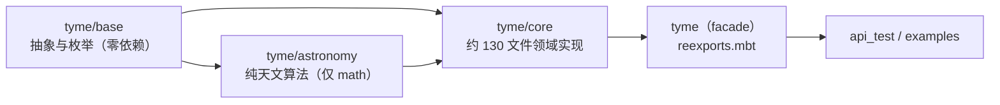

# Architecture

库分为四个 MoonBit 包，依赖方向严格单向，无任何循环：

包声明为 `moon.pkg`、模块声明为 `moon.mod`（依赖 feature flags `rr_moon_pkg` / `rr_moon_mod`，工具链 moon 0.1.20260920）。工具链版本、trait 提升约定等环境细节以根目录 `AGENTS.md` 的"MoonBit 项目环境"一节为唯一权威，本页不重复。

## 抽象模型（tyme/base）

全库只有两个核心接口：`Culture { get_name }`（[culture.mbt](../tyme/base/culture.mbt)）和 `Tyme: Culture { next(Self, Int) -> Self }`（[tyme.mbt](../tyme/base/tyme.mbt)）。`next(n)` 是统一的推移原语：所有历法对象（日期、干支、神煞、星期……）都靠它前进或后退，n 可为负。

- `LoopTyme`（[loop_tyme.mbt](../tyme/base/loop_tyme.mbt)）：环形名称索引 `{ names, index }`，提供 `index_of_name`（按名查找，返回 `Result`）、`steps_to / steps_back_to / steps_close_to` 等步数计算。绝大多数文化类型是"struct 内嵌一个 LoopTyme + 方法转发"的组合模式（干支、天干、地支、节气、神煞、星期、生肖……）。
- `AbstractCultureDay[C]`（[abstract_culture_day.mbt](../tyme/base/abstract_culture_day.mbt)）：泛型"文化对象 + 第 N 天"，输出"XX第N天"；三伏、物候、数九、月相等带天序的类型都内嵌它（见 [domain-culture.md](domain-culture.md)）。
- `AbstractCulture::index_of / floor_div`：环形索引归一化与向下取整除法，全库复用的静态工具。
- 时间单位 `DayUnit / MonthUnit / YearUnit / SecondUnit` 的 `get_compare_index` 把年月日时分秒打成一个可比较整数，支撑 `is_before / is_after`。

## 重导出链与兼容边界

公开符号经过**三层 `pub using` 透传**：

1. [tyme/core/imports.mbt](../tyme/core/imports.mbt)：`pub using @astronomy`（天文函数）+ `pub using @base`（抽象与枚举）汇入 core；
2. [tyme/reexports.mbt](../tyme/reexports.mbt)：单条 `pub using @core { ... }` **显式符号清单**（当前 211 个公开符号，见 [tyme/pkg.generated.mbti](../tyme/pkg.generated.mbti)），是历史 `@tyme.*` 兼容边界——文件头注释明确"此清单有意重导出旧名称"。

`pkg.generated.mbti` 由 `moon info` 生成并纳入版本控制，是 API 面的验收护栏：既有重构以"mbti 字节不变"为护栏，扩展功能以"只增不改"为准。修改公开 API 的标准流程见本页"工程约定"。

## 可变性收敛

MoonBit 值语义下，全库的可变状态收敛到少数全局 `Ref[T]` 单点，其余类型全部为不可变 struct：

| Ref | 文件 | 作用 |
|-----|------|------|
| `event_manager_data` | [event_manager.mbt](../tyme/core/event_manager.mbt) | 事件注册表（`Map[String,String]`） |
| `legal_holiday_data` | [legal_holiday.mbt](../tyme/core/legal_holiday.mbt) | 法定假日数据串，`set_data` 可整体替换 |
| `solar_festival_data` / `lunar_festival_data` | [solar_festival.mbt](../tyme/core/solar_festival.mbt) / [lunar_festival.mbt](../tyme/core/lunar_festival.mbt) | 节日数据串 |
| `eight_char_provider` | [eight_char.mbt](../tyme/core/eight_char.mbt) | 八字流派（`Ref[&IEightCharProvider]`） |
| `child_limit_provider` | [child_limit.mbt](../tyme/core/child_limit.mbt) | 童限流派（`Ref[&IChildLimitProvider]`） |

策略类切换（流派 provider）与数据热替换（假日/事件）都走这些单点；查询永远只读。注意 `tyme/astronomy/astronomy_constants.mbt` 的数据表是 `pub let`，理论上可被外部改写（见 [astronomy.md](astronomy.md) 的已知问题）。

## 工程约定与修改流程

CI 链（[.github/workflows/ci.yml](../.github/workflows/ci.yml)）：`moon fmt --check` → `moon check --deny-warn` → `moon build` → 多目标构建（wasm-gc / wasm / js / native）→ `moon test --deny-warn`。任何 warning 都会失败，这直接驱动了 `AGENTS.md` 中的 trait 方法显式提升约定（每个 `pub impl Trait for T` 须配 `pub extend T with Trait::{...}`，`Show` 必须同时列出 `output`）。

修改或新增公开 API 时的固定动作：

1. 实现域代码与白盒测试（`*_wbtest.mbt`）；
2. 按需更新 [tyme/reexports.mbt](../tyme/reexports.mbt) 的显式符号清单（新符号不写进清单则包外不可见）；
3. 运行 `moon info` 刷新各包 `pkg.generated.mbti` 并提交；
4. 在 `api_test/` 补黑盒可达性或数值测试（黑盒包只能 import `tyme`，不能复用 core 的 test_helper）；
5. `moon fmt && moon check --deny-warn && moon test` 本地全绿。

## 拆包现状

[ROADMAP.md](../ROADMAP.md)（2026-08-16）规划把 `tyme/core`（143 文件 / 约 1298 个公开 API）按"叶子优先"七阶段拆成多个包，但结论是**暂不执行**：`SolarDay / LunarDay / SixtyCycle / SolarTime` 是互为依赖的 hub 类型，`Week↔SevenStar`、`Element↔Direction`、`SolarDay→Phase→SolarTime→SolarDay` 存在类型环，拆包需改写 core 内部 1000+ 处 `@pkg.` 前缀，当前"单 core 包 + facade 兼容层"是性价比最高的平衡点。新增代码时应继续沿用现有文件分组命名（`solar_*`、`lunar_*`、`sixty_cycle*`、`rab_byung_*`、`hijri_*`、`shensha_*` 等），不要引入新的包边界。
